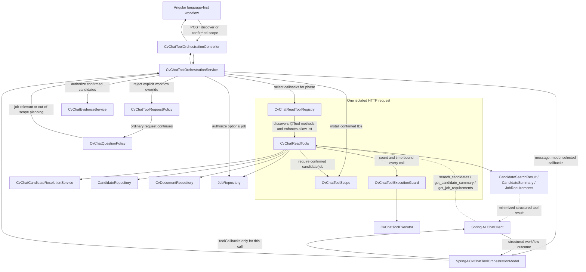

# Spring AI Tools and Controlled Agent Actions

## Objective

Use Spring AI tool calling to let the CV-chat model retrieve current authorized application data and request narrowly defined recruitment operations without granting the model direct access to repositories, databases, provider credentials, or authorization decisions.

The model may select a tool and propose structured arguments. The application remains responsible for authorization, validation, execution, confirmation, auditing, rate limits, and result minimization.

## Added value compared with existing APIs

Spring AI tools do not replace the existing REST APIs or domain services. The APIs remain the deterministic
application boundary and source of truth:

```text
Angular or another client
-> REST API
-> authorized domain service
-> database
```

A tool is a narrow model-facing adapter around an existing authorized capability:

```text
Recruiter message
-> application selects the tools allowed for this workflow phase
-> model requests one specific tool
-> application validates and authorizes the request
-> existing domain service executes
-> minimized structured result returns to the model
-> model prepares a controlled or cited response
```

For a fixed form or known interaction, tools add little value. If the recruiter has already selected candidates and a
job and pressed **Compare**, Angular can call the deterministic comparison API directly and should continue to do so.
Routing that known operation through a model would add latency, provider cost, nondeterminism, testing complexity, and
another failure boundary without improving the workflow.

Tools become valuable for the planned dedicated conversational CV-chat page. A request such as:

> Compare Fanon and Boris against the approved senior backend role, and tell me whose CV still needs review.

may require the assistant to coordinate several existing capabilities:

1. Search candidate names inside the authenticated organization.
2. Ask the recruiter to resolve missing or ambiguous references.
3. Retain only the explicitly confirmed candidate scope.
4. Retrieve bounded requirements for the explicitly selected approved job.
5. Inspect authorized document, malware-scan, OCR, or review status.
6. Retrieve authorized current CV evidence.
7. Produce a grounded comparison with citations.

Without tools, the frontend or backend must predict each conversational sequence and implement a dedicated endpoint or
workflow for every supported combination. A small reviewed tool set lets the assistant plan among reusable operations
while application code still controls authorization and execution. This provides:

- natural-language orchestration without one endpoint per recruiter phrasing;
- reusable capabilities for the future web-chat page, speech input, Telegram, and WhatsApp;
- contextual clarification when required names, scope, or criteria are missing;
- composition across candidate, job, document-status, evaluation-evidence, and later dashboard queries;
- smaller model context because only the required minimized records are retrieved; and
- current application data at execution time instead of stale data copied into a long prompt.

Those benefits do not justify making every API a tool. The project deliberately uses a hybrid architecture:

- REST controllers and domain services remain the source of truth.
- Angular calls APIs directly whenever the workflow and operation are already known.
- Application code selects which tools are registered for each phase and role.
- Authentication, tenant isolation, record authorization, validation, and limits remain deterministic server-side
  checks rather than prompt instructions.
- Candidate cards require explicit human confirmation, and the model cannot create or widen candidate scope.
- Grounded comparison remains a separate evidence-and-citation service.
- Future state-changing or externally communicating tools require a deterministic preview, explicit confirmation,
  idempotency, and an audit record.

Therefore, the practical value is not “another way to call the same API.” Tools provide controlled composition for a
flexible conversational assistant. They are useful where the recruiter may express many valid multi-step workflows in
natural language, but direct APIs remain preferable for simple deterministic UI actions.

## Initial read-only tools

Implement a small, request-scoped tool set after the underlying domain services and authorization model exist:

- `searchCandidates` for bounded organization-scoped candidate discovery.
- `getCandidateProfile` for an authorized, minimized candidate view.
- `getJobRequirements` for approved comparison criteria.
- `compareCandidates` for structured comparison inputs and evidence.
- `getEvaluationEvidence` for metric-level source references and evaluation history.
- `getDocumentStatus` and `getIngestionWarnings` for CV processing state.
- `getOpenJobMetrics`, `getCandidatePipelineSummary`, and other governed dashboard aggregates.

Tools must expose domain services rather than arbitrary SQL, repository access, filesystem access, HTTP access, or generic code execution.

### Implemented foundation

The internal request-scoped foundation currently provides:

- `search_candidates`, available during discovery and returning bounded tenant-scoped identity cards;
- `get_candidate_summary`, available only after application code authorizes and confirms candidate IDs; and
- `get_job_requirements`, available only when application code also authorizes and confirms one approved job ID.

The approved-job callback returns bounded title, level, summary, responsibility, qualification, and soft-skill fields.
It deliberately excludes organization identifiers, salary, benefits, tone, and job-generation metadata. A selected job
is looked up inside the authenticated organization before its ID enters the immutable request scope. The callback is
not registered at all when no job has been confirmed, and the tool independently repeats tenant authorization when
executed. Candidate-only planning therefore cannot call the approved-job tool.

The reviewed backend contract now exposes two authenticated, CSRF-protected phases:

- `POST /api/chat/tools/discover` accepts only bounded recruiter text and registers candidate search;
- `POST /api/chat/tools/confirmed-scope` accepts bounded text, one to five explicitly confirmed candidate IDs, and an
  optional explicitly confirmed approved-job ID.

Both endpoints are limited to `ADMIN`, `RECRUITER`, and `REVIEWER`. Organization and roles come exclusively from the
authenticated session. Extra model/client fields cannot override them, and responses contain only the validated
workflow kind and presentation message—never candidate IDs, job IDs, tenant context, roles, or authorization state.
Provider failures retain structured safe HTTP errors. PR #144 connected the Angular language-first workflow to both
phases: discovery gates deterministic candidate-card lookup, and confirmed-scope planning runs only after every card
is explicitly selected. Clarification/refusal stops before lookup, `CONFIRMED_SCOPE_READY` alone may populate the
visible comparison scope, and grounded evidence retrieval remains a separate recruiter action. Stale results are
discarded when the message, selected cards, or optional approved job changes. Staging acceptance remains pending.

Explicit instructions to ignore, bypass, skip, fake, assume, override, or disable confirmation, authorization,
tenant, role, tool, or scope controls are rejected by `CvChatToolRequestPolicy` before any provider or tool call. This
is a deliberately narrow deterministic boundary rather than a general natural-language classifier. Ordinary requests
continue to `CvChatQuestionPolicy` and the tool-enabled orchestration model. During discovery, the model must call
`search_candidates` separately for each referenced person using only that person's partial name. One or several
legitimate cards for every requested person produces `CANDIDATE_CONFIRMATION_REQUIRED`; a missing result produces
`CLARIFICATION_REQUIRED`, and Angular resolves ambiguity through explicit card selection.

### Tool-class relationship

The following diagram separates the HTTP/orchestration layer, Spring AI callback layer, request-local security state,
and existing deterministic data services. Solid arrows represent ordinary method calls or dependency delegation;
dotted arrows represent callbacks that Spring AI may invoke after the application attaches them to one model request.



The main responsibilities are:

- `CvChatToolOrchestrationController` exposes the two authenticated HTTP phases and obtains organization context from
  the authenticated principal rather than the request body.
- `CvChatToolOrchestrationService` owns deterministic phase transitions, pre-tool policy checks, candidate/job
  authorization, request-scope installation, callback selection, and validation of the model's structured outcome.
- `CvChatToolRequestPolicy` detects explicit attempts to weaken protected workflow controls. A matching request is
  refused before semantic classification, provider access, or callback execution. It is intentionally narrow and
  complements rather than replaces multilingual semantic policy evaluation and adversarial tests.
- `CvChatQuestionPolicy` performs the existing semantic sensitive-question classification. Its evidence-oriented
  `OUT_OF_SCOPE` result is not automatically a tool-orchestration refusal because legitimate candidate discovery is
  outside the narrower evidence-question vocabulary.
- `SpringAiCvChatToolOrchestrationModel` builds the reviewed prompt and attaches only the callbacks selected for that
  invocation through `toolCallbacks(...)`; it does not make the tools global.
- `CvChatReadToolRegistry` converts `@Tool` methods into Spring AI callbacks, verifies an exact closed allow list, and
  returns different callback subsets for discovery, confirmed candidates, and confirmed candidates plus a job.
- `CvChatReadTools` implements the three model-facing read operations. Each operation independently authenticates,
  enforces tenant and confirmed-record scope, delegates to deterministic services/repositories, and minimizes output.
- `CvChatToolScope` holds immutable human-confirmed candidate and optional job IDs for the current HTTP request.
- `CvChatToolExecutionGuard` gives each request a separate call budget, while the singleton `CvChatToolExecutor` runs
  approved work on virtual threads with a timeout. It contains no tenant or authorization state.
- `CandidateCard`, `CandidateSearchResult`, `CandidateSummary`, `CurrentDocumentStatus`, and `JobRequirements` are
  bounded transfer records. They define what may cross from deterministic application code into the model context.

## Trusted context and authorization

- Resolve user identity, organization, roles, locale, and request correlation data from trusted application context, not model-generated tool arguments.
- Apply organization and record authorization inside every tool invocation even when upstream retrieval already applied a filter.
- Make only the tools permitted for the current user and conversation purpose available to each `ChatClient` request.
- Avoid globally shared default tools for privileged or context-specific operations.
- Reject unknown, cross-organization, deleted, expired, or unauthorized identifiers without revealing whether protected records exist.
- Return the minimum candidate data required and prefer identifiers, structured summaries, evidence references, and authenticated links over full CV text.

## Query and command separation

Classify tools into two categories:

1. Query tools are read-only, bounded, and may run automatically when authorized.
2. Command tools change state or communicate externally and require an explicit approval workflow.

Potential command tools include requesting OCR reprocessing, preparing a shortlist, saving a recruiter note, requesting reevaluation, preparing a candidate message, or scheduling an interview. Use the sequence:

```text
model proposes action
-> application creates a deterministic preview
-> user reviews the exact effect
-> user confirms
-> domain service executes with an idempotency key
-> application writes an audit record
```

Never expose tools that directly approve jobs, reject or hire candidates, change scoring rules, bypass consent, weaken retention, select an organization, or send messages without confirmation.

## Prompt-injection and misuse controls

CVs, chat messages, OCR text, transcripts, and external messages are untrusted inputs. A document instruction must never change tool permissions or application policy.

- Keep command tools unavailable during untrusted document-analysis prompts unless the workflow explicitly requires one.
- Enforce authorization and business invariants in deterministic services, not prompts or tool descriptions.
- Reject explicit workflow-override language through `CvChatToolRequestPolicy` before provider or callback access;
  keep the model prompt and provider evaluation as additional defenses rather than the primary boundary.
- Search each named candidate separately. Never pass a complete multi-candidate recruiter sentence as one partial-name
  tool argument, and let the deterministic Angular card picker resolve one-to-many identity matches.
- Limit tool-call count, recursion depth, result count, execution time, payload size, and returned fields.
- Apply timeouts, circuit breakers, provider rate limits, bulkheads or semaphores, cancellation, and safe retry policies.
- Prevent arbitrary queries, unrestricted exports, generic URLs, shell commands, code execution, and filesystem paths.
- Test malicious inputs that attempt cross-tenant retrieval, data export, tool substitution, hidden actions, or confirmation bypass.

## Observability and privacy

- Record tool name, authenticated actor, organization, outcome, duration, result count, correlation ID, confirmation reference, and policy decision.
- Do not place CV text, prompts, transcripts, tool arguments, tool results, credentials, or unnecessary candidate data in ordinary logs or traces.
- Keep content-bearing tool telemetry disabled by default.
- Monitor tool errors, timeouts, denied calls, repeated invocation, provider throttling, and unusual result volumes.
- Apply chat, candidate, audio, and audit retention policies to corresponding tool-call metadata.
- Correlate tool duration, outcome, denial, confirmation, timeout, retry, and result count through privacy-safe metrics and traces while keeping arguments and results disabled.

## Multichannel reuse

Typed CV chat, speech-enabled CV chat, Telegram, and WhatsApp must use the same authorized tool layer. Channel adapters may reduce the available tool set and returned detail, but they must not reimplement candidate retrieval or weaken security. External messaging should return minimized summaries and authenticated web links rather than full CV records.

## Concurrency

Tool calls that wait on JDBC, Spring AI, Object Storage, OCR, speech, or messaging providers may benefit from virtual-thread orchestration. Every scarce dependency still requires independent concurrency limits. CPU-intensive PDF, OCR, image, and video work remains on bounded workers or isolated jobs.

## Spring AI version boundary

The repository currently uses Spring AI `1.1.0`. Implement against documentation and APIs matching the pinned version. Evaluate a Spring AI 2.x upgrade separately because its preferred tool-execution lifecycle uses `ChatClient` with `ToolCallingAdvisor`, and framework behavior must not be changed implicitly during the first tool rollout.

Before an upgrade:

- Review the official migration and tool-calling notes.
- Pin compatible model and Spring AI versions.
- Run unit, integration, authorization, prompt-injection, and tool-loop regression tests.
- Verify tool resolution, schema generation, result conversion, observability, and retry behavior.

## Learning sources and project mapping

The implementation was derived primarily from official Spring documentation. The versioned Spring AI links below
describe the `1.1.x` API family used by this repository; the project remains pinned to Spring AI `1.1.0`, so examples
must still be checked against the dependency actually compiled by Maven rather than copied blindly from a newer patch
or from Spring AI 2.x.

1. [Spring AI 1.1 Tool Calling](https://docs.spring.io/spring-ai/reference/1.1/api/tools.html) explains the complete
   tool lifecycle: the application publishes a name, description, and input schema; the model may request a call; the
   application executes the matching `ToolCallback`; and the result returns to the model. It also documents
   declarative `@Tool` methods, `ToolCallback`, `ToolCallbacks.from(...)`, result conversion, exception handling, and
   observability. This is the foundation for `CvChatReadTools`, `CvChatReadToolRegistry`, and the bounded callback
   results used here. The guide explicitly states that the model never receives direct access to the underlying API;
   that is why every callback delegates to an authorized application service instead of exposing repositories or SQL.
2. [Spring AI 1.1 ChatClient API](https://docs.spring.io/spring-ai/reference/1.1/api/chatclient.html) explains the fluent
   `prompt()`, `system(...)`, `user(...)`, `options(...)`, `call()`, and `content()` sequence used by
   `SpringAiCvChatToolOrchestrationModel`. Its distinction between defaults and request-specific configuration supports
   this project's choice to attach callbacks only to the reviewed orchestration call rather than make privileged or
   context-specific tools globally available.
3. [Spring Framework bean scopes](https://docs.spring.io/spring-framework/reference/core/beans/factory-scopes.html)
   explains that a request-scoped bean has one instance per HTTP request and how scoped proxies allow it to be injected
   into longer-lived beans. That is the reason `CvChatReadTools`, `CvChatReadToolRegistry`, `CvChatToolScope`, and
   `CvChatToolExecutionGuard` use `@RequestScope`: mutable authorization scope and execution state cannot leak from one
   recruiter's HTTP request into another.
4. [Spring AI Evaluation Testing](https://docs.spring.io/spring-ai/reference/api/testing.html) explains why generated
   behavior requires evaluation in addition to deterministic unit tests, and why an evaluation model may differ from
   the generation model. The opt-in orchestration provider evaluation applies that principle to representative normal,
   ambiguous, sensitive, out-of-scope, injection, and confirmation-bypass cases. Normal CI remains deterministic and
   provider-free; the live dataset test is an explicit release/review gate because it incurs cost and can vary with the
   provider. The evaluation mirrors production application gates: explicit confirmation-bypass input is refused by
   `CvChatToolRequestPolicy` without asking the provider to enforce application authorization, while ordinary and
   ambiguous discovery cases still exercise the live question-policy, tool-calling, and orchestration behavior.

These references explain the framework mechanics, not this application's authorization policy. Tenant isolation,
confirmed candidate scope, approved-job scope, read-only exposure, bounded results, timeout handling, and refusal
ordering are project security decisions enforced and tested by application code. A framework feature or model prompt
must never be treated as a substitute for those deterministic controls.

## Security and AI engineering sources

The non-Spring design decisions are informed by the following primary or standards-oriented sources. They support the
principles used here; they do not replace a project-specific threat model, legal review, or automated verification.

1. [OWASP LLM01:2025 Prompt Injection](https://genai.owasp.org/llmrisk/llm01-prompt-injection/) explains that direct
   recruiter text and indirect content such as CVs, OCR output, websites, or files can attempt to change model
   behavior. Its mitigations include separating untrusted content, constraining model behavior, validating outputs,
   applying least privilege, requiring approval for high-risk actions, and adversarial testing. These principles map
   to marked untrusted prompt blocks, application-owned workflow state, deterministic response validation, per-phase
   callback registration, injection datasets, and the rule that CV evidence is data rather than policy.
2. [OWASP LLM06:2025 Excessive Agency](https://genai.owasp.org/llmrisk/llm062025-excessive-agency/) describes the risk
   created by excessive tool functionality, permissions, or autonomy. It supports this project's small read-only tool
   set, tenant- and record-level authorization inside every callback, absence of generic SQL/HTTP/filesystem tools, and
   requirement for preview plus explicit confirmation before any future state-changing or external action.
3. [OpenAI evaluation best practices](https://developers.openai.com/api/docs/guides/evaluation-best-practices) recommends
   defining an evaluation objective, collecting representative datasets, selecting explicit metrics, comparing runs,
   and continuously adding observed failures. This maps to versioned human-reviewed datasets, deterministic contract
   tests, opt-in provider evaluations, multilingual/adversarial cases, and promotion gates after staging observations.
   Provider-backed evaluation complements unit and integration tests; it does not make normal CI depend on a billable,
   nondeterministic external service.
4. [NIST AI Risk Management Framework](https://www.nist.gov/itl/ai-risk-management-framework) and the
   [NIST Generative AI Profile](https://nvlpubs.nist.gov/nistpubs/ai/NIST.AI.600-1.pdf) organize AI risk work around
   governance, mapping context and impact, measurement, and ongoing management. They support the broader roadmap of
   documented human oversight, privacy and security controls, measurable quality and performance acceptance, incident
   visibility, and revalidation when prompts, tools, providers, models, data, or deployment conditions change.

Source-to-control mapping should remain explicit. For example, “least privilege” becomes a bounded callback list and
server-side authorization tests; “human oversight” becomes confirmed candidate cards and approval gates; and
“continuous evaluation” becomes a reviewed dataset that grows whenever staging or production exposes a new failure.
Merely linking a standard without implementing and testing the corresponding control is not sufficient.

## Acceptance criteria

- Every tool delegates to an authorized, validated domain service.
- Organization and user context cannot be supplied or overridden by the model.
- Read-only tools return bounded, minimized, evidence-linked results.
- Every state-changing or external action requires an exact preview and explicit user confirmation.
- Command execution is idempotent and audited.
- Malicious CVs, transcripts, and messages cannot expand tool access or cross organization boundaries.
- Tool-call count, time, payload, recursion, concurrency, and result limits are enforced.
- Typed web chat, voice chat, and external messaging reuse the same policy-controlled tool layer.
- Sensitive tool content is absent from normal logs and traces.
- Version-matched Spring AI integration and upgrade behavior are covered by automated tests.
