# Spring AI Tools and Controlled Agent Actions

## Objective

Use Spring AI tool calling to let the CV-chat model retrieve current authorized application data and request narrowly defined recruitment operations without granting the model direct access to repositories, databases, provider credentials, or authorization decisions.

The model may select a tool and propose structured arguments. The application remains responsible for authorization, validation, execution, confirmation, auditing, rate limits, and result minimization.

## Added value compared with existing APIs

Spring AI tools do not replace the existing REST APIs or domain services. The APIs remain the deterministic
application boundary and source of truth:

```text
Angular or another client
-> REST API
-> authorized domain service
-> database
```

A tool is a narrow model-facing adapter around an existing authorized capability:

```text
Recruiter message
-> application selects the tools allowed for this workflow phase
-> model requests one specific tool
-> application validates and authorizes the request
-> existing domain service executes
-> minimized structured result returns to the model
-> model prepares a controlled or cited response
```

For a fixed form or known interaction, tools add little value. If the recruiter has already selected candidates and a
job and pressed **Compare**, Angular can call the deterministic comparison API directly and should continue to do so.
Routing that known operation through a model would add latency, provider cost, nondeterminism, testing complexity, and
another failure boundary without improving the workflow.

Tools become valuable for the planned dedicated conversational CV-chat page. A request such as:

> Compare Fanon and Boris against the approved senior backend role, and tell me whose CV still needs review.

may require the assistant to coordinate several existing capabilities:

1. Search candidate names inside the authenticated organization.
2. Ask the recruiter to resolve missing or ambiguous references.
3. Retain only the explicitly confirmed candidate scope.
4. Retrieve bounded requirements for the explicitly selected approved job.
5. Inspect authorized document, malware-scan, OCR, or review status.
6. Retrieve authorized current CV evidence.
7. Produce a grounded comparison with citations.

Without tools, the frontend or backend must predict each conversational sequence and implement a dedicated endpoint or
workflow for every supported combination. A small reviewed tool set lets the assistant plan among reusable operations
while application code still controls authorization and execution. This provides:

- natural-language orchestration without one endpoint per recruiter phrasing;
- reusable capabilities for the future web-chat page, speech input, Telegram, and WhatsApp;
- contextual clarification when required names, scope, or criteria are missing;
- composition across candidate, job, document-status, evaluation-evidence, and later dashboard queries;
- smaller model context because only the required minimized records are retrieved; and
- current application data at execution time instead of stale data copied into a long prompt.

Those benefits do not justify making every API a tool. The project deliberately uses a hybrid architecture:

- REST controllers and domain services remain the source of truth.
- Angular calls APIs directly whenever the workflow and operation are already known.
- Application code selects which tools are registered for each phase and role.
- Authentication, tenant isolation, record authorization, validation, and limits remain deterministic server-side
  checks rather than prompt instructions.
- Candidate cards require explicit human confirmation, and the model cannot create or widen candidate scope.
- Grounded comparison remains a separate evidence-and-citation service.
- Future state-changing or externally communicating tools require a deterministic preview, explicit confirmation,
  idempotency, and an audit record.

Therefore, the practical value is not “another way to call the same API.” Tools provide controlled composition for a
flexible conversational assistant. They are useful where the recruiter may express many valid multi-step workflows in
natural language, but direct APIs remain preferable for simple deterministic UI actions.

## Initial read-only tools

Implement a small, request-scoped tool set after the underlying domain services and authorization model exist:

- `searchCandidates` for bounded organization-scoped candidate discovery.
- `getCandidateProfile` for an authorized, minimized candidate view.
- `getJobRequirements` for approved comparison criteria.
- `compareCandidates` for structured comparison inputs and evidence.
- `get_evaluation_evidence` for bounded persisted evaluation history. The current schema does not yet retain
  metric-level source references, and the tool intentionally excludes generated rationale because it can contain
  candidate personal information or quoted CV content.
- `get_document_status` and `get_ingestion_warnings` for minimized CV processing state and safe warning codes.
- `getOpenJobMetrics`, `getCandidatePipelineSummary`, and other governed dashboard aggregates.

Tools must expose domain services rather than arbitrary SQL, repository access, filesystem access, HTTP access, or generic code execution.

### Implemented foundation

The internal request-scoped foundation currently provides:

- `search_candidates`, available during discovery and returning bounded tenant-scoped identity cards;
- `get_candidate_summary`, available only after application code authorizes and confirms candidate IDs; and
- `get_job_requirements`, available only when application code also authorizes and confirms one approved job ID; and
- `get_evaluation_evidence`, implemented as a dedicated future evaluation-aware callback subset and available only for
  a candidate already authorized and confirmed by application code;
- `get_document_status`, returning the newest document's bounded operational state for a candidate already authorized
  and confirmed by application code; and
- `get_ingestion_warnings`, returning application-owned processing warning codes for that newest document without raw
  parser, OCR, malware-scanner, or provider details.

`get_evaluation_evidence` returns at most the five most recent persisted evaluations for one confirmed candidate. Its
minimized result contains evaluation/job identifiers, bounded job title, persisted scores, creation and invalidation
timestamps, and explicit current/stale state. It omits the generated evaluation rationale, candidate name,
organization, contact details, CV text, storage metadata, hashes, prompts, provider configuration, and model metadata.
Generated rationale is untrusted historical model output and may contain candidate personal information or quoted CV
content, so bounding its length would not make it appropriate tool context. Complete reproducibility still requires
the planned persistence of prompts, model configuration, weights, source-document/text fingerprints, and metric-level
evidence references.

The registry exposes this operation through an explicit `evaluationEvidenceCallbacks()` subset. It is deliberately not
part of the current confirmed-scope preflight: that preflight validates that the provider can read confirmed candidate
summaries and an optional confirmed job, then discards the provider-written response before the separate grounded
comparison runs. Registering evaluation history there would add database reads, provider context, and tool calls
without changing the user-visible comparison. A future evaluation-aware conversational answer path must opt into this
dedicated subset and consume its minimized result explicitly.

Focused staging acceptance completed on 10 November 2026 at main revision `5455b32` after PR #157. The deployed
backend remained healthy; a same-tenant candidate with persisted evaluations returned bounded history with job IDs,
scores, creation timestamps, and coherent current/stale invalidation state; missing and cross-tenant candidate access
retained the generic `404` boundary; and existing single- and multi-candidate chat paths remained functional. Automated
callback tests additionally cover the five-row bound and truncation probe, confirmed-scope enforcement, tenant
consistency across candidate/job/evaluation records, privacy-minimized projection, and omission of generated rationale.
This is acceptance of the read-tool foundation and its supporting domain contract only. The current chat path does not
register or consume this callback subset, so user-visible evaluation-aware chat has not yet been accepted. No Flyway,
Compose, frontend, or runtime environment-variable change was required. Production repeated the focused backend
health, tenant-boundary, persisted-history, current/stale-state, missing/cross-tenant, and existing-chat regression
checks successfully on 10 November 2026. The production result has the same boundary: it validates the deployed tool
foundation, not user-visible evaluation-aware chat consumption.

The document-status foundation follows the same boundary. `get_document_status` returns only candidate/document IDs,
ingestion status, extraction method, import time, and optional reprocessing time. A confirmed candidate with no document
returns a null current document rather than appearing missing. `get_ingestion_warnings` returns only the bounded codes
`NO_DOCUMENT_AVAILABLE`, `MANUAL_REVIEW_REQUIRED`, `INGESTION_FAILED`, or `PROCESSING_WARNING_RECORDED`; it never
returns the persisted raw ingestion error. Both operations first require the exact application-confirmed candidate ID,
then resolve the candidate and newest document with organization predicates so missing and cross-tenant IDs retain the
same generic boundary. Their explicit `documentStatusCallbacks()` subset is excluded from discovery and confirmed-scope
preflight. A later processing-aware answer path must opt in and consume the results deliberately. Automated unit and
real-callback tests cover scope rejection, tenant filtering, newest-document selection, no-document behavior, minimized
schemas, raw-error omission, and the closed callback allow list. No environment, Flyway, database, Compose, or frontend
change is required.

The approved-job callback returns bounded title, level, summary, responsibility, qualification, and soft-skill fields.
It deliberately excludes organization identifiers, salary, benefits, tone, and job-generation metadata. A selected job
is looked up inside the authenticated organization before its ID enters the immutable request scope. The callback is
not registered at all when no job has been confirmed, and the tool independently repeats tenant authorization when
executed. Candidate-only planning therefore cannot call the approved-job tool.

The reviewed backend contract now exposes two authenticated, CSRF-protected phases:

- `POST /api/chat/tools/discover` accepts only bounded recruiter text, extracts one to five candidate references, and
  invokes the tenant-scoped candidate search deterministically for every extracted reference;
- `POST /api/chat/tools/confirmed-scope` accepts bounded text, one to five explicitly confirmed candidate IDs, and an
  optional explicitly confirmed approved-job ID.

Both endpoints are limited to `ADMIN`, `RECRUITER`, and `REVIEWER`. Organization and roles come exclusively from the
authenticated session. Extra model/client fields cannot override them. Confirmed-scope responses contain only the
validated workflow kind and presentation message. The additive discovery response keeps those top-level fields and
may also contain `candidateScope`, but only after Java has performed every required authenticated candidate search.
Its minimal candidate IDs, names, and titles are application-owned tenant-scoped cards for human confirmation, never
model-proposed scope or authorization state. It never contains job IDs, tenant context, roles, or authorization facts.
Discovery/reference and pre-tool policy failures retain structured safe HTTP errors. The non-authoritative
confirmed-scope tool preflight instead degrades to the application-owned ready state and emits a privacy-safe warning.
PR #144 connected the Angular language-first workflow to both phases. The one-pass discovery correction now collects
the exact `search_candidates` results already used to make the application-owned discovery decision and returns them
in `candidateScope`; Angular no longer repeats name extraction through `/api/chat/candidates/scope`. The legacy endpoint
remains temporarily available for cached-client compatibility. A confirmation without candidate cards fails closed,
and clarification/refusal returns a null scope. Confirmed-scope validation runs only after every card is explicitly
selected. After deterministic policy checks and tenant
authorization of every confirmed candidate and optional approved job, Java returns `CONFIRMED_SCOPE_READY`; a model
cannot reinterpret or randomly refuse that trusted state. After authorization, Spring AI receives only the minimum
confirmed-scope callbacks for a bounded tool-orchestration preflight. It must read every confirmed candidate summary
and, when selected, the approved job. Request-scoped postconditions verify those calls. Provider-written presentation
text is discarded. Missing calls, malformed output, provider refusal, or provider failure returns the same
application-owned ready message instead of revoking scope, injecting unsupported claims, or returning a
provider-dependent workflow error. Success and degraded fallback have distinct privacy-safe log events so staging can
prove whether the tool path actually completed; a READY HTTP result alone is not tool-preflight acceptance evidence.
Grounded evidence retrieval remains a separate recruiter action. The final comparison endpoint repeats tenant
authorization for every candidate and any optional approved job, builds a bounded `CvChatComparisonJobContext`, and
passes only an application-owned `approvedJobSelected` fact into question policy. The comparison model receives bounded
job requirements only when that job was explicitly selected; candidate-only comparison remains valid without a job.
`JobRequirements` is model context, never authorization state.

Stale results are discarded when the message, selected cards, or optional approved job changes. Starting a new
language-first discovery clears the previous language-derived cards, confirmed IDs, comparison question/job context,
answer, and errors before the request is sent. The request text and optional approved-job selector remain inputs for
the new discovery. A refusal, clarification, or delayed response therefore cannot leave an earlier language scope
visible. This reset deliberately does not erase independently assembled picker-first selections.

Focused staging acceptance completed on 10 November 2026 at main revision `22d56c5` after PRs #146–#154. The accepted
checks covered deterministic two-to-five-person discovery, bounded ambiguity cards, sensitive/unrelated refusal,
candidate-only and approved-job confirmed scope, complete tool-preflight postconditions, cited grounded comparison,
privacy-safe diagnostics, and stale language-scope clearing. Production repeated the focused checks successfully on
10 November 2026 in release `v0.32.0` at revision `1a5f247`.

Explicit instructions to ignore, bypass, skip, fake, assume, override, or disable confirmation, authorization,
tenant, role, tool, or scope controls are rejected by `CvChatToolRequestPolicy` before any provider or tool call. This
is a deliberately narrow deterministic boundary rather than a general natural-language classifier. Ordinary requests
continue to `CvChatQuestionPolicy`. During discovery, `CvChatCandidateReferenceExtractor` interprets only the bounded
human-readable references; Java then calls `search_candidates` separately for every extracted person. The provider is
not allowed to refuse before those mandatory searches run. One or several legitimate cards for every requested person
produces `CANDIDATE_CONFIRMATION_REQUIRED`; the same authorized card results are included in that response rather than
being re-created by a second provider call. A missing result produces `CLARIFICATION_REQUIRED`, and Angular resolves
ambiguity through explicit card selection. `CvChatToolDiscoveryState` records request-local search counts, and
`CvChatToolDiscoveryDecision` makes the transition from those authorized facts. Four Fanon cards still represent one
successful reference, for example; a second successful Yogish search is enough to show both card groups for human
selection. The state never logs or persists search text, candidate names, or cards; only privacy-safe aggregate counts
are exposed to orchestration diagnostics. The earlier provider-owned confirmed-scope transition was removed after a
valid three-candidate, explicitly selected-job request was incorrectly refused. Tool callbacks now provide a bounded
tool-orchestration preflight after authorization, but they do not decide whether confirmed scope is ready.

### Tool-class relationship

The following diagram separates the HTTP/orchestration layer, Spring AI callback layer, request-local security state,
and existing deterministic data services. Solid arrows represent ordinary method calls or dependency delegation;
dotted arrows represent callbacks that Spring AI may invoke after the application attaches them to one model request.

```mermaid
flowchart TD
    Angular[Angular language-first workflow]
    Controller[CvChatToolOrchestrationController]
    Service[CvChatToolOrchestrationService]
    RequestPolicy[CvChatToolRequestPolicy]
    SemanticPolicy[CvChatQuestionPolicy]
    ReferenceExtractor[CvChatCandidateReferenceExtractor]
    Evidence[CvChatEvidenceService]
    Model[SpringAiCvChatToolOrchestrationModel]
    ChatClient[Spring AI ChatClient]

    subgraph RequestScope[One isolated HTTP request]
        Registry[CvChatReadToolRegistry]
        Scope[CvChatToolScope]
        DiscoveryState[CvChatToolDiscoveryState]
        PlanningState[CvChatToolPlanningState]
        Tools[CvChatReadTools]
        Guard[CvChatToolExecutionGuard]
    end

    Executor[CvChatToolExecutor]
    Search[CvChatCandidateResolutionService]
    CandidateRepo[CandidateRepository]
    DocumentRepo[CvDocumentRepository]
    JobRepo[JobRepository]
    EvaluationService[EvaluationHistoryService]
    EvaluationRepo[CandidateEvaluationRepository]
    Results[CandidateSearchResult / CandidateSummary / JobRequirements]
    EvaluationResult[EvaluationEvidenceResult]
    DiscoveryResponse[CvChatToolDiscoveryResponse with application-owned candidateScope]

    Angular -->|POST discover or confirmed-scope| Controller
    Controller --> Service
    Service -->|reject explicit workflow override| RequestPolicy
    RequestPolicy -->|ordinary request continues| SemanticPolicy
    SemanticPolicy -->|job-relevant or out-of-scope planning| Service
    Service -->|authorize confirmed candidates| Evidence
    Service -->|authorize optional job| JobRepo
    Service -->|install confirmed IDs| Scope
    Service -->|extract bounded names during discovery| ReferenceExtractor
    Service -->|invoke mandatory discovery searches| Tools
    Service -->|minimum confirmed-scope callback subset| Registry
    Registry -->|discovers @Tool methods and enforces allow list| Tools
    Service -->|authorized advisory planning request| Model
    Model -->|request-local toolCallbacks| ChatClient
    ChatClient -.->|bounded read callbacks| Tools
    Tools -->|record privacy-safe search outcome| DiscoveryState
    Tools -->|record authorized summary/job IDs read| PlanningState
    Tools -->|require confirmed candidate/job| Scope
    Tools -->|count and time-bound every call| Guard
    Guard --> Executor
    Tools --> Search
    Tools --> CandidateRepo
    Tools --> DocumentRepo
    Tools --> JobRepo
    Tools -.->|explicit future evaluation-aware subset| EvaluationService
    EvaluationService -.->|privacy-minimized projection| EvaluationRepo
    Tools --> Results
    Results -.->|minimized structured tool result| ChatClient
    Tools -.-> EvaluationResult
    EvaluationResult -.->|future evaluation-aware consumer| ChatClient
    Results -->|reuse authorized discovery cards| DiscoveryResponse
    Service -->|validated kind and optional scope| DiscoveryResponse
    DiscoveryResponse -->|one-pass confirmation response| Angular
    DiscoveryState -->|aggregate search snapshot| Service
    PlanningState -->|verify every expected tool call occurred| Service
    Service -->|apply CvChatToolDiscoveryDecision| Service
    Service --> Controller
    Controller --> Angular
```



The main responsibilities are:

- `CvChatToolOrchestrationController` exposes the two authenticated HTTP phases and obtains organization context from
  the authenticated principal rather than the request body.
- `CvChatToolOrchestrationService` owns deterministic phase transitions, pre-tool policy checks, candidate/job
  authorization, and mandatory discovery searches. Once confirmed IDs pass those checks, it owns the ready state and
  runs a provider/tool preflight while always returning application-owned workflow text.
- `CvChatToolRequestPolicy` detects explicit attempts to weaken protected workflow controls. A matching request is
  refused before semantic classification, provider access, or callback execution. It is intentionally narrow and
  complements rather than replaces multilingual semantic policy evaluation and adversarial tests.
- `CvChatQuestionPolicy` supplies the sensitive-question boundary before any tool reads. Its evidence-oriented
  `OUT_OF_SCOPE` result is handled by the later grounded chat/comparison service rather than this scope-management
  phase, preventing a second provider classification from randomly refusing an otherwise authorized transition.
- `SpringAiCvChatToolOrchestrationModel` performs the production tool-orchestration preflight after deterministic
  authorization. It receives trusted IDs separately from untrusted recruiter text, must call the minimized tools for
  every trusted ID, and cannot authorize, refuse, change the confirmed workflow state, or supply UI text.
- `CvChatReadToolRegistry` converts `@Tool` methods into Spring AI callbacks, verifies an exact closed allow list, and
  returns explicit callback subsets for confirmed candidates, confirmed candidates plus a job, and the foundational
  evaluation-history capability. The evaluation subset is not registered in the current comparison preflight.
- `CvChatReadTools` implements the four model-facing read operations. Each operation independently authenticates,
  enforces tenant and confirmed-record scope, delegates to deterministic services/repositories, and minimizes output.
  The evaluation operation queries through `EvaluationHistoryService`, caps history at five items, and omits generated
  rationale and metric-level evidence that is not safely available in the current persistence model.
- `CvChatToolDiscoveryState` records request-local search-call, distinct-success, and empty-result counts without
  exposing queries or candidate data. It is new for every HTTP request and cannot leak discovery state between users.
- `CvChatToolDiscoveryDecision` converts authorized discovery facts into application-owned postconditions: at least
  one successful search with no missing person requires candidate confirmation, while any empty search
  requires clarification. Sensitive and workflow-override requests are rejected before this state can be populated.
- `CvChatToolPlanningState` records only the authorized candidate/job IDs whose minimized tools completed during this
  HTTP request. The service uses it as a postcondition; it stores no names, CV text, job text, prompts, or tool results.
- `CvChatToolScope` holds immutable human-confirmed candidate and optional job IDs for the current HTTP request.
- `CvChatToolExecutionGuard` gives each request a separate call budget, while the singleton `CvChatToolExecutor` runs
  approved work on virtual threads with a timeout. It contains no tenant or authorization state.
- `CandidateCard`, `CandidateSearchResult`, `CandidateSummary`, `CurrentDocumentStatus`, and `JobRequirements` are
  bounded transfer records. They define what may cross from deterministic application code into the model context.

The diagram ends at confirmed-scope readiness intentionally. `CvChatComparisonService` is the later, separate evidence
boundary: it reauthorizes candidate IDs and the optional job, applies the comparison question policy, retrieves bounded
CV evidence, calls `CvChatComparisonModel`, and validates complete citations. Tool preflight cannot bypass or replace
that path.

## Trusted context and authorization

- Resolve user identity, organization, roles, locale, and request correlation data from trusted application context, not model-generated tool arguments.
- Apply organization and record authorization inside every tool invocation even when upstream retrieval already applied a filter.
- Make only the tools permitted for the current user and conversation purpose available to each `ChatClient` request.
- Avoid globally shared default tools for privileged or context-specific operations.
- Reject unknown, cross-organization, deleted, expired, or unauthorized identifiers without revealing whether protected records exist.
- Return the minimum candidate data required and prefer identifiers, structured summaries, evidence references, and authenticated links over full CV text.

## Query and command separation

Classify tools into two categories:

1. Query tools are read-only, bounded, and may run automatically when authorized.
2. Command tools change state or communicate externally and require an explicit approval workflow.

Potential command tools include requesting OCR reprocessing, preparing a shortlist, saving a recruiter note, requesting reevaluation, preparing a candidate message, or scheduling an interview. Use the sequence:

```text
model proposes action
-> application creates a deterministic preview
-> user reviews the exact effect
-> user confirms
-> domain service executes with an idempotency key
-> application writes an audit record
```

Never expose tools that directly approve jobs, reject or hire candidates, change scoring rules, bypass consent, weaken retention, select an organization, or send messages without confirmation.

## Prompt-injection and misuse controls

CVs, chat messages, OCR text, transcripts, and external messages are untrusted inputs. A document instruction must never change tool permissions or application policy.

- Keep command tools unavailable during untrusted document-analysis prompts unless the workflow explicitly requires one.
- Enforce authorization and business invariants in deterministic services, not prompts or tool descriptions.
- Reject explicit workflow-override language through `CvChatToolRequestPolicy` before provider or callback access;
  keep the model prompt and provider evaluation as additional defenses rather than the primary boundary.
- Search each named candidate separately. Never pass a complete multi-candidate recruiter sentence as one partial-name
  tool argument, and let the deterministic Angular card picker resolve one-to-many identity matches.
- Limit tool-call count, recursion depth, result count, execution time, payload size, and returned fields.
- Apply timeouts, circuit breakers, provider rate limits, bulkheads or semaphores, cancellation, and safe retry policies.
- Prevent arbitrary queries, unrestricted exports, generic URLs, shell commands, code execution, and filesystem paths.
- Test malicious inputs that attempt cross-tenant retrieval, data export, tool substitution, hidden actions, or confirmation bypass.

## Observability and privacy

- Record tool name, authenticated actor, organization, outcome, duration, result count, correlation ID, confirmation reference, and policy decision.
- Do not place CV text, prompts, transcripts, tool arguments, tool results, credentials, or unnecessary candidate data in ordinary logs or traces.
- Keep content-bearing tool telemetry disabled by default.
- Monitor tool errors, timeouts, denied calls, repeated invocation, provider throttling, and unusual result volumes.
- Apply chat, candidate, audio, and audit retention policies to corresponding tool-call metadata.
- Correlate tool duration, outcome, denial, confirmation, timeout, retry, and result count through privacy-safe metrics and traces while keeping arguments and results disabled.

## Multichannel reuse

Typed CV chat, speech-enabled CV chat, Telegram, and WhatsApp must use the same authorized tool layer. Channel adapters may reduce the available tool set and returned detail, but they must not reimplement candidate retrieval or weaken security. External messaging should return minimized summaries and authenticated web links rather than full CV records.

## Concurrency

Tool calls that wait on JDBC, Spring AI, Object Storage, OCR, speech, or messaging providers may benefit from virtual-thread orchestration. Every scarce dependency still requires independent concurrency limits. CPU-intensive PDF, OCR, image, and video work remains on bounded workers or isolated jobs.

## Spring AI version boundary

The repository currently uses Spring AI `2.0.2`. Implement against documentation and APIs matching that pinned
version. The migration remains deliberately separate from tool feature work so framework lifecycle changes can be
validated through deterministic, provider, authorization, tenant-isolation, pgvector, and deployment regression gates.

Before an upgrade:

- Review the official migration and tool-calling notes.
- Pin compatible model and Spring AI versions.
- Run unit, integration, authorization, prompt-injection, and tool-loop regression tests.
- Verify tool resolution, schema generation, result conversion, observability, and retry behavior.

## Learning sources and project mapping

The implementation was derived primarily from official Spring documentation. The historical 1.1 links below explain
the design used to create the original tool layer; current implementation work must use the Spring AI 2.0 reference
and must still be checked against the exact `2.0.2` dependency compiled by Maven.

1. [Spring AI Tool Calling](https://docs.spring.io/spring-ai/reference/api/tools.html) explains the complete
   tool lifecycle: the application publishes a name, description, and input schema; the model may request a call; the
   application executes the matching `ToolCallback`; and the result returns to the model. It also documents
   declarative `@Tool` methods, `ToolCallback`, `ToolCallbacks.from(...)`, result conversion, exception handling, and
   observability. This is the foundation for `CvChatReadTools`, `CvChatReadToolRegistry`, and the bounded callback
   results used here. The guide explicitly states that the model never receives direct access to the underlying API;
   that is why every callback delegates to an authorized application service instead of exposing repositories or SQL.
2. [Spring AI ChatClient API](https://docs.spring.io/spring-ai/reference/api/chatclient.html) explains the fluent
   `prompt()`, `system(...)`, `user(...)`, `options(...)`, `call()`, and `content()` sequence used by
   `SpringAiCvChatToolOrchestrationModel`. Its distinction between defaults and request-specific configuration supports
   this project's choice to attach callbacks only to the reviewed orchestration call rather than make privileged or
   context-specific tools globally available.
3. [Spring Framework bean scopes](https://docs.spring.io/spring-framework/reference/core/beans/factory-scopes.html)
   explains that a request-scoped bean has one instance per HTTP request and how scoped proxies allow it to be injected
   into longer-lived beans. That is the reason `CvChatReadTools`, `CvChatReadToolRegistry`, `CvChatToolScope`, and
   `CvChatToolExecutionGuard`, and `CvChatToolPlanningState` use `@RequestScope`: mutable authorization scope and
   execution/postcondition state cannot leak from one recruiter's HTTP request into another.
4. [Spring AI Evaluation Testing](https://docs.spring.io/spring-ai/reference/api/testing.html) explains why generated
   behavior requires evaluation in addition to deterministic unit tests, and why an evaluation model may differ from
   the generation model. The opt-in orchestration provider evaluation applies that principle to representative normal,
   ambiguous, sensitive, out-of-scope, injection, and confirmation-bypass cases. Normal CI remains deterministic and
   provider-free; the live dataset test is an explicit release/review gate because it incurs cost and can vary with the
   provider. The evaluation mirrors production application gates: explicit confirmation-bypass input is refused by
   `CvChatToolRequestPolicy` without asking the provider to enforce application authorization. Confirmed-scope cases
   use the same callback subsets as production and assert that each synthetic confirmed candidate—and the optional
   selected job—was actually read exactly once; a READY label without those calls fails the evaluation.
5. The community-maintained [Prompt Engineering Guide](https://www.promptingguide.ai/) is a useful supplemental learning
   index for prompt elements, zero- and few-shot techniques, prompt chaining, retrieval-augmented generation, tool use,
   agents, context engineering, and adversarial prompting. Use it to generate design alternatives and evaluation cases,
   not as framework-version or security authority. Any adopted technique must preserve the application-owned trust
   boundaries in this specification and pass deterministic, provider-backed, multilingual, and adversarial tests before
   promotion.

These references explain the framework mechanics, not this application's authorization policy. Tenant isolation,
confirmed candidate scope, approved-job scope, read-only exposure, bounded results, timeout handling, and refusal
ordering are project security decisions enforced and tested by application code. A framework feature or model prompt
must never be treated as a substitute for those deterministic controls.

## Security and AI engineering sources

The non-Spring design decisions are informed by the following primary or standards-oriented sources. They support the
principles used here; they do not replace a project-specific threat model, legal review, or automated verification.

1. [OWASP LLM01:2025 Prompt Injection](https://genai.owasp.org/llmrisk/llm01-prompt-injection/) explains that direct
   recruiter text and indirect content such as CVs, OCR output, websites, or files can attempt to change model
   behavior. Its mitigations include separating untrusted content, constraining model behavior, validating outputs,
   applying least privilege, requiring approval for high-risk actions, and adversarial testing. These principles map
   to marked untrusted prompt blocks, application-owned workflow state, deterministic response validation, per-phase
   callback registration, injection datasets, and the rule that CV evidence is data rather than policy.
2. [OWASP LLM06:2025 Excessive Agency](https://genai.owasp.org/llmrisk/llm062025-excessive-agency/) describes the risk
   created by excessive tool functionality, permissions, or autonomy. It supports this project's small read-only tool
   set, tenant- and record-level authorization inside every callback, absence of generic SQL/HTTP/filesystem tools, and
   requirement for preview plus explicit confirmation before any future state-changing or external action.
3. [OpenAI evaluation best practices](https://developers.openai.com/api/docs/guides/evaluation-best-practices) recommends
   defining an evaluation objective, collecting representative datasets, selecting explicit metrics, comparing runs,
   and continuously adding observed failures. This maps to versioned human-reviewed datasets, deterministic contract
   tests, opt-in provider evaluations, multilingual/adversarial cases, and promotion gates after staging observations.
   Provider-backed evaluation complements unit and integration tests; it does not make normal CI depend on a billable,
   nondeterministic external service.
4. [NIST AI Risk Management Framework](https://www.nist.gov/itl/ai-risk-management-framework) and the
   [NIST Generative AI Profile](https://nvlpubs.nist.gov/nistpubs/ai/NIST.AI.600-1.pdf) organize AI risk work around
   governance, mapping context and impact, measurement, and ongoing management. They support the broader roadmap of
   documented human oversight, privacy and security controls, measurable quality and performance acceptance, incident
   visibility, and revalidation when prompts, tools, providers, models, data, or deployment conditions change.

Source-to-control mapping should remain explicit. For example, “least privilege” becomes a bounded callback list and
server-side authorization tests; “human oversight” becomes confirmed candidate cards and approval gates; and
“continuous evaluation” becomes a reviewed dataset that grows whenever staging or production exposes a new failure.
Merely linking a standard without implementing and testing the corresponding control is not sufficient.

## Acceptance criteria

- Every tool delegates to an authorized, validated domain service.
- Organization and user context cannot be supplied or overridden by the model.
- Read-only tools return bounded, minimized, evidence-linked results.
- Every state-changing or external action requires an exact preview and explicit user confirmation.
- Command execution is idempotent and audited.
- Malicious CVs, transcripts, and messages cannot expand tool access or cross organization boundaries.
- Tool-call count, time, payload, recursion, concurrency, and result limits are enforced.
- Typed web chat, voice chat, and external messaging reuse the same policy-controlled tool layer.
- Sensitive tool content is absent from normal logs and traces.
- Version-matched Spring AI integration and upgrade behavior are covered by automated tests.
